# FLIM Studio — User Manual

This manual covers every control, panel, and mode of operation in FLIM
Studio's desktop interface. It assumes the application is already running
— see [README.md](README.md) to launch from source, or
[BUILDING.md](BUILDING.md) to build/run the standalone `.exe`.

---

## 1. Window layout

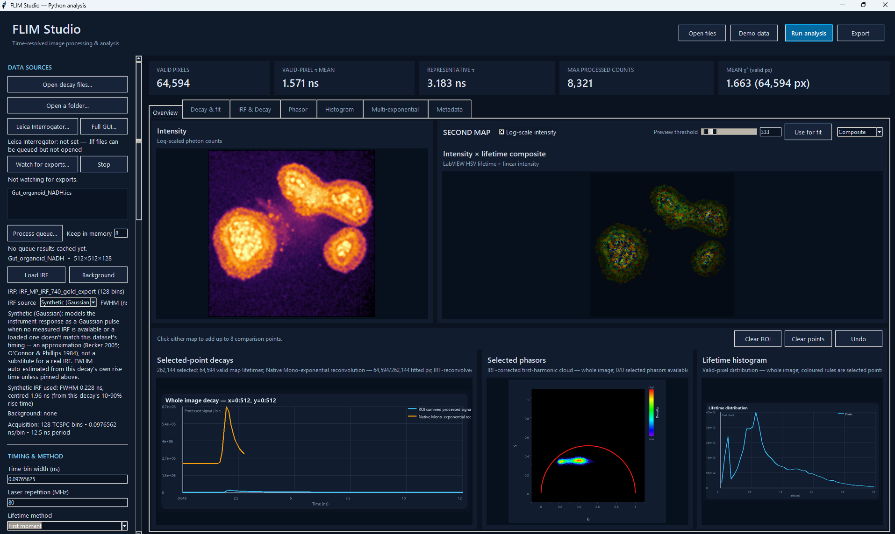

The window has four regions:

- **Header** (top) — quick-access buttons: `Open files`, `Demo data`,
  `Run analysis`, `Export`.
- **Sidebar** (left) — every analysis setting, organised into sections
  (§3).
- **Content area** (right) — a metrics strip plus a tabbed set of views
  (§5).
- **Status bar** (bottom) — current status message and a progress bar.

---

## 2. Loading data

### Opening files
- **Open decay files…** (sidebar or header) — pick one or more decay
  files. Multiple selections fill the **queue list**, and the first one
  loads automatically. `.lif` files (raw Leica acquisitions) can be
  selected here too — see §2.3.
- **Open a folder…** — queues every supported file in a folder
  (`.ics`/`.ids`, `.npy`/`.npz`, `.tif`/`.tiff`, `.csv`/`.txt`, `.lif`).
  If a `.ics` header and its `.ids` companion are both present, only the
  `.ics` is queued.
- The **queue list** shows every queued file. Click an entry to load and
  analyse it (or show a cached result — see §6.2). A `●` marker means a
  cached result already exists for that entry; `◇` marks a `.lif` entry
  (see §2.3) — it isn't directly analysable data. Ctrl/shift-click to
  select more than one entry (this doesn't load/show anything while
  multiple are selected), then **Remove selected** to drop just those
  from the queue — their cached results, if any, go with them. **Clear
  queue** empties it entirely. Neither touches anything on disk.

### Reference data
- **Load IRF** — the instrument response function for reconvolution
  fitting and phasor IRF correction. Required for any FLIMLib
  reconvolution/global/apply-model method (§4) — unless the sidebar's
  **Synthetic (Gaussian)** IRF source is selected instead (§3), which
  removes that requirement entirely.
- **Background** — a dark/background acquisition subtracted from every
  sample before any other processing (§6.1).

Both accept the same file types as sample data, and can be a single
decay trace, a per-pixel cube matching the sample's shape, or (for
background) a flat scalar via the **Additional scalar background**
field instead of a file.

### 2.3 Leica `.lif` files (via Leica Interrogator)

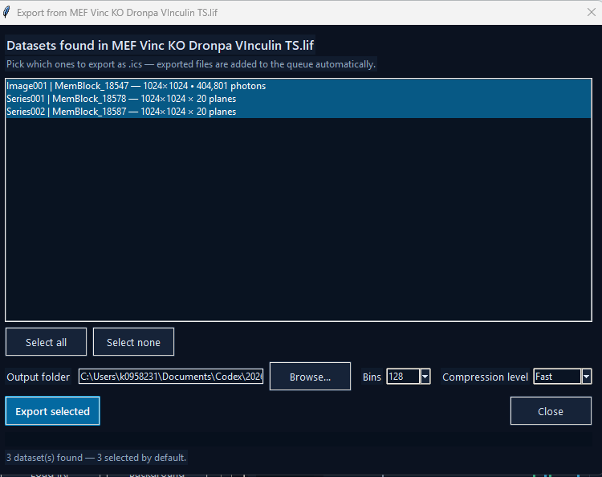

FLIM Studio doesn't decode Leica's raw `.lif` format itself. Instead it
calls a **Leica Interrogator** converter — running as an isolated
subprocess, the same crash-isolation approach used for native FLIMLib
fitting — to turn `.lif` acquisitions into `.ics` files it can analyse
normally, without leaving FLIM Studio for the common case.

**No setup needed for the common case**: a packaged FLIM Studio build
already includes a built-in `.lif` reader, so queuing and exporting a
`.lif` (below) just works, with nothing to install or configure first.
**Leica Interrogator…** (sidebar, DATA SOURCES) only needs to be set if
you *also* want Interrogator's own **Full GUI…** for manual preview —
that's a separate, full installation of "Leica Interrogator Desktop"
with its own Python environment, and it takes priority over the built-in
reader whenever it's configured (so if the picker below behaves
unexpectedly after setting it, an easy check is clearing that field again
to fall back to the built-in reader).

**Exporting a `.lif` (the quick path)**:
1. Queue the `.lif` via **Open decay files…**/**Open a folder…** — it
   shows up marked `◇`.
2. Click it in the queue. FLIM Studio scans it and opens a picker
   listing every FLIM dataset found inside — a single `.lif` commonly
   contains many (multiple series, timepoints, channels/detectors), so
   this lets you choose which ones matter rather than exporting
   everything blind.
3. Tick the ones you want (all are selected by default), set an output
   folder, **Bins**, and **Compression level** (`Fast`/`Balanced`/`Max`
   — trades export speed against file size; decoding time, not
   compression, is the main cost for large multi-plane series).
4. **Export selected** — progress streams live (a message plus a
   progress bar) rather than appearing to hang while a large series
   decodes. Exported `.ics` files are added straight to the main
   queue automatically, ready to analyse — no manual re-import step.

**Full GUI…** (next to the Leica Interrogator button) launches
Interrogator's own standalone application instead, for when you'd
rather preview/browse there before exporting anything.

**Watch for exports…** / **Stop** — point this at a folder (e.g.
wherever the full Interrogator GUI saves its exports) and FLIM Studio
polls it every couple of seconds, adding any new `.ics` files it finds
straight to the queue automatically. This is specifically for the
**Full GUI…** path — the picker dialog above already adds its own
exports to the queue without needing a watch folder.

Batch operations (**Process queue…**, **Process & export queue**, §6.2)
skip `.lif` entries with a clear message rather than failing on them —
export to `.ics` first.

---

## 3. Sidebar reference

The sidebar, top to bottom:

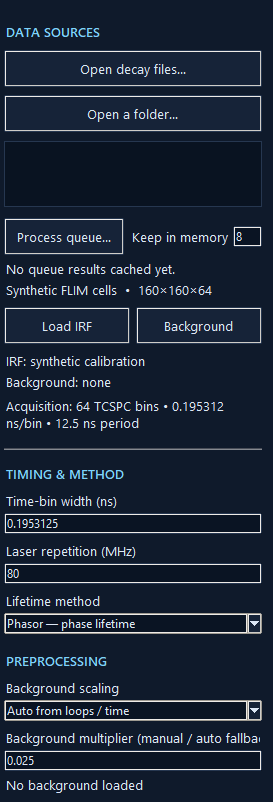
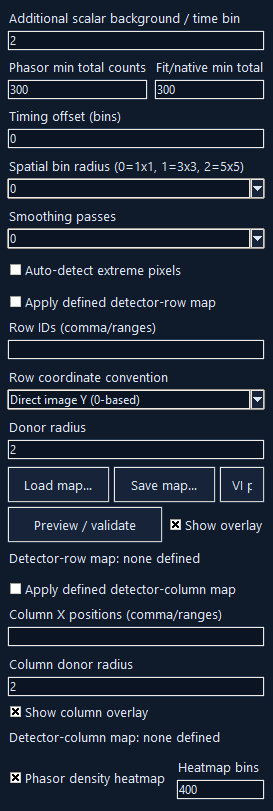
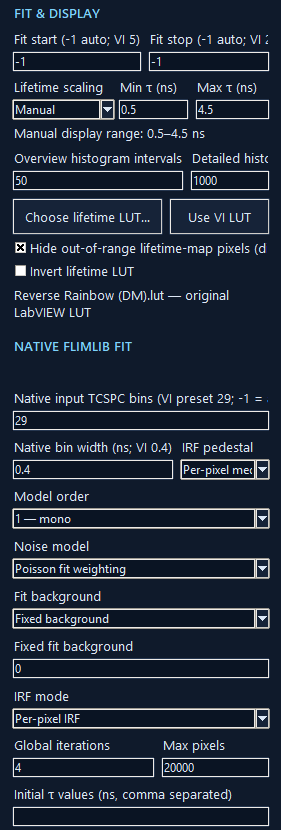
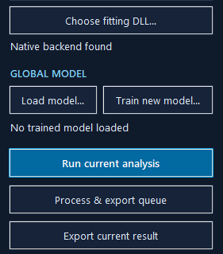

### SETTINGS PRESET

The very top of the sidebar. Every choice covered in this section — every
control below, in every section — can be saved to and loaded from a plain
`.ini` file:
- **Load…** / **Save as…** — pick any `.ini` file to load from or save the
  current sidebar state to.
- **Save as default** — saves to `default.ini` next to the application
  (the project folder when running from source, or next to
  `FLIM Studio.exe` in a packaged build). **This file loads automatically
  every time FLIM Studio starts**, so it's how you make your own settings
  the ones you see on launch instead of the built-in defaults — no need to
  re-enter them each session, or hand them to a colleague running the same
  acquisition setup: give them the `.ini` file (or drop it next to their
  copy of the exe as `default.ini`).
- **Reset** — reverts every control back to FLIM Studio's own built-in
  defaults (not `default.ini`, if one was loaded — use **Load…** on a
  saved file to go back to that instead).

A settings file only covers analysis *choices* — method, timing,
thresholds, spatial binning, native fit conditions, display ranges, IRF
source, and so on. It doesn't include anything about a specific loaded
file (the sample/IRF/background paths, or the queue) — those aren't
"initial values for a choice" so much as "whatever happens to be open
right now". Loading one that's missing or has an unrecognised value for
some field (e.g. saved by a newer version with a choice this one predates)
skips just that field with a warning, rather than failing the whole load.

### DATA SOURCES
Covered in §2 and §2.3 (**Open decay files…**, **Open a folder…**,
**Leica Interrogator…**, **Full GUI…**, **Watch for exports…**/**Stop**,
**Load IRF**, **Background**), plus:
- **Keep in memory** — how many queue results `Process queue…` keeps
  cached at once (§6.2).
- **IRF source** — `Loaded file` (default) uses whatever's loaded via
  **Load IRF**, or nothing if none is loaded. **Synthetic (Gaussian)**
  ignores any loaded file entirely and models the instrument response
  as a Gaussian pulse instead:

  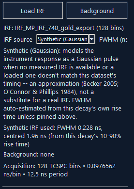

  This is a standard TCSPC/FLIM approximation (Becker, *Advanced
  TCSPC Techniques*, 2005; O'Connor & Phillips, *Time-Correlated Single
  Photon Counting*, 1984) for when no measured IRF is available, or a
  loaded one doesn't match the current dataset's timing/bin count.
  **FWHM (ns, -1=auto)** — leave at `-1` to auto-estimate the width from
  this decay's own 10–90% rise time (for the large majority of FLIM
  data, that rise is dominated by the instrument response, not the
  fluorescence itself — the standard practical estimator when no real
  IRF exists), or enter a known value to pin it. After a run, a summary
  line reports what was actually used, e.g. *"Synthetic IRF used: FWHM
  0.228 ns, centred 1.96 ns (from this decay's 10-90% rise time)"* — see
  the IRF & Decay tab (§5.3) to check it visually against the real
  decay. It's an approximation, not a substitute for a real measured
  IRF — it can't capture a genuine detector afterpulsing tail or real
  pulse asymmetry.

### TIMING & METHOD
- **Time-bin width (ns)** / **Laser repetition (MHz)** — acquisition
  timing, pre-filled from the loaded file's metadata but editable.
- **Lifetime method** — selects the analysis mode; see §4 for what each
  one does.

### PREPROCESSING
- **Background scaling** — `Auto from loops / time` derives the
  background subtraction multiplier from acquisition metadata (loop
  count / integration time); `Manual multiplier` lets you set it
  directly via the **Background multiplier** field below it.
- **Background multiplier (manual / auto fallback)** — the scale factor
  applied to the loaded background before subtraction; also the
  fallback value if auto-derivation isn't possible.
- **Additional scalar background / time bin** — a flat per-bin offset
  subtracted everywhere, independent of any loaded background file.
- **Phasor min total counts** / **Fit/native min total counts** — per-
  pixel intensity thresholds below which a pixel is excluded from the
  phasor calculation or the fit, respectively.
- **Timing offset (bins)** — shifts the decay (and IRF) along the time
  axis by a (possibly fractional) number of bins, applied right after
  background subtraction.
- **Spatial bin radius** — 0 = no binning, 1 = sums a 3×3 neighbourhood
  into each pixel, 2 = 5×5, etc. This is a *rolling* window centred on
  every pixel, not traditional block-binning — the lifetime/intensity
  maps stay at the acquisition's full resolution at any radius (a
  512×512 acquisition stays 512×512), with each pixel's own value
  becoming the sum of its local neighbourhood for better per-pixel
  photon statistics. Edge/corner pixels sum whatever's actually within
  the array bounds (their true spatial support) rather than a
  padded/fabricated neighbourhood. ROI and whole-image aggregate sums
  (total photon counts, the summed decay curve, etc.) are computed
  independently of this and are unaffected by the radius you choose.
- **Smoothing passes** — number of light spatial-smoothing passes
  applied before binning.
- **Auto-detect extreme pixels** — automatically finds and replaces
  dead/outlier pixels with a local median before smoothing.

**Detector-row map** — corrects known bad/dead detector rows on your
array by interpolating them from neighbouring rows:
- **Apply defined detector-row map** — enables the correction.
- **Row IDs (comma/ranges)** — e.g. `4, 10-12, 30` — the rows to
  replace.
- **Row coordinate convention** — whether row IDs are direct image-Y
  (0-based) or the original LabVIEW detector-row numbering (mirrored).
- **Donor radius** — how many neighbouring rows on each side to
  interpolate from.
- **Load map… / Save map…** — persist a row map to/from a file.
- **VI preset** — loads the row map matching the original LabVIEW VI's
  hardcoded bad-row list, for parity with legacy processing.
- **Preview / validate** — checks the map against the current dataset's
  dimensions and previews its effect.
- **Show overlay** — draws the affected rows on the intensity/second
  map views.

**Detector-column map** — the same correction, along columns instead of
rows: **Apply defined detector-column map**, **Column X positions**,
**Column donor radius**, **Show column overlay**.

Row/column correction runs *after* background subtraction and *before*
smoothing/binning — see the exact order in §6.1.

- **Phasor density heatmap** — colours the phasor plot by point density
  (a LUT-coloured heatmap) instead of plotting discrete dots.
  **Heatmap bins** sets its resolution.

### FIT & DISPLAY
- **Fit start / Fit stop** — the bin range used for mono-exponential and
  moment fitting (`-1` = auto-detect from the decay peak).
- **Lifetime scaling** — `Auto` sets the lifetime-map colour range from
  the data; `Manual` uses the **Min τ / Max τ (ns)** fields you set.
- **Overview histogram intervals** / **Detailed histogram bins** — bin
  counts for the small Overview-tab histogram vs. the full Histogram
  tab.
- **Choose lifetime LUT… / Use VI LUT** — load a custom 256-colour
  ImageJ `.lut` file for lifetime-map colouring, or revert to the
  bundled default (matching the original LabVIEW VI's LUT).
- **Hide out-of-range lifetime-map pixels** — display-only: pixels
  outside the Min τ/Max τ range are hidden rather than clamped to the
  end colour.
- **Invert lifetime LUT** — flips the colour ramp direction.

### NATIVE FLIMLIB FIT
Settings for FLIMLib reconvolution fitting (mono/bi/tri-exponential),
run via the native DLL in an isolated subprocess:
- **Native input TCSPC bins** — how many leading time bins to hand to
  the native fit (`-1` = all).
- **Native bin width mode** — `Auto` (default) makes the native fit
  assume the same bin width as **Time-bin width** (§3, TIMING & METHOD),
  updating automatically if that changes; `Manual` instead uses whatever's
  typed into **Native bin width (ns)** below it, ignored entirely in Auto
  mode. A summary line reports which is actually in effect and its
  resolved value. Leave this on `Auto` unless you have a specific reason
  the native fit needs a *different* bin width than the data's own —
  a mismatch here silently scales every reconvolution-fit lifetime by
  the ratio between the two, which is essentially never what you want.
- **Native bin width (ns)** — the bin width the native fit assumes, when
  **Native bin width mode** above is set to `Manual`.
- **IRF pedestal** — how to remove a DC offset from the IRF before
  fitting: `Per-pixel median`, `Tail median` (median of the last few
  bins), or `None`.
- **Reconvolution fit worker processes** — `1` (default) fits the whole
  image in one subprocess call, same as always. A higher value splits the
  image into that many row-bands and fits each concurrently in its own
  subprocess — real wall-clock speedup on a multi-core machine, with
  identical results (every pixel is already fitted fully independently,
  so this is exact, not an approximation). Only applies to **FLIMLib —
  reconvolution** — the global/apply-model methods fit one τ jointly
  across every selected pixel and always stay single-process, since
  chunking those would silently compute a different τ per chunk.
- **Model order** — `1 — mono`, `2 — bi`, or `3 — tri` exponential
  components.
- **Distribution model** — only affects **Train new model…** and
  Lifetime method **FLIMLib — global shared τ** (§4.6); no effect on
  reconvolution or apply-trained-model analysis.
  - `Multi-exponential (discrete τ)` (default) — Model order discrete
    lifetimes.
  - `Stretched exponential (distribution)` — fits one lifetime as a
    (τ, h) distribution instead of a discrete component
    (`I(t) = Z + A·exp(-(t/τ)^(1/h))`; h=1 is a plain exponential, h>1
    a broader spread of rates). Forces **Model order** to `1 — mono` —
    always exactly one component.
  - `Multi-stretched exponential (independent components)` — extends
    the above to up to 3 **independently-distributed** (τ, h)
    components summed together; set **Model order** to how many (2-3).
    For this option, the Training dialog's own **Auto-seed from phasor
    analysis** checkbox (§4.6 step 4) is the recommended way to start
    the fit — it reliably finds every component with no manual guess
    needed, which plain unseeded fitting is not always guaranteed to do
    at Model order 3.
- **Noise model** — `Poisson MLE`, `Poisson fit weighting`, `Poisson
  data weighting`, or `Constant weighting`.
- **Fit background** — `Fit / free background` lets the fit solve for
  its own background level; `Fixed background` uses the value in
  **Fixed fit background** instead.
- **IRF mode** — `Global IRF` uses one shared IRF for the whole image;
  `Per-pixel IRF` uses a per-pixel IRF cube if the loaded IRF file has
  matching spatial dimensions.
- **Global iterations** / **Max pixels** — iteration cap and a pixel-
  count cap (for performance, not correctness) used by the global-fitting
  methods (**FLIMLib — global shared τ**, and global model training —
  §4.6). **Max pixels = 0** removes the cap entirely — every valid pixel
  from every image is used, at the cost of a slower run. With a nonzero
  cap and more than one training image, the budget is split fairly
  across all of them rather than spent entirely on whichever image comes
  first.
- **Initial τ values (ns, comma separated)** — starting lifetime guesses
  for multi-exponential fitting. Leave blank for the ordinary unseeded
  search, or (for global model training with the multi-stretched
  distribution model) check the Training dialog's own **Auto-seed from
  phasor analysis** box instead of typing values here — see §4.6 step 4
  for all three seeding options.
- **Choose fitting DLL…** — point at a specific `flimfit_labview.dll` if
  it isn't auto-detected; the status line below shows which one is
  active.

### GLOBAL MODEL
- **Load model…** — load a previously trained/saved global model
  (`.json`) for Application mode (§4.7).
- **Train new model…** — opens the Training dialog (§4.6).

---

## 4. Modes of operation (Lifetime method)

Select via the sidebar's **Lifetime method** dropdown.

### 4.1 Phasor — phase lifetime / 4.2 Phasor — modulation lifetime
Computes the first-harmonic phasor (G, S) per pixel from the Fourier
transform of each decay, optionally IRF-corrected (per-pixel or global,
depending on **IRF mode**; loaded file or synthetic Gaussian, depending
on **IRF source** — §3). Reports lifetime from either the phase angle
(`arctan(S/G)`) or the modulation depth (`|G+iS|`). Fast, vectorised,
no iterative fitting — good for a quick look or for phasor-space
analysis (see the Phasor plot, §5.4).

### 4.3 Mono-exponential fit
A fast, vectorised weighted log-linear fit of a single exponential
decay per pixel over the **Fit start/stop** bin range. No native DLL or
IRF deconvolution involved.

### 4.4 First moment
Computes lifetime from the decay's first temporal moment (mean photon
arrival time relative to the IRF's own centroid, if an IRF is loaded or
synthesised).

### 4.5 FLIMLib — reconvolution
A single-component (mono-exponential) fit against the IRF, run through
the native FLIMLib DLL in a subprocess (crash-isolated from the main
GUI). Requires an IRF — either loaded, or the sidebar's **Synthetic
(Gaussian)** IRF source (§3). Uses the **NATIVE FLIMLIB FIT** settings
(noise model, background mode, IRF mode, etc.).

### 4.6 FLIMLib — global shared τ
Bi- or tri-exponential fitting (per **Model order**) where the
component lifetimes (τ) are shared/fixed across every pixel in the
image and only the per-pixel amplitudes vary — this is what populates
the **Multi-exponential** tab (§5.6). Requires an IRF (loaded or
synthetic, as above).

This is *not* the same as multi-image global-model **training** (§4.6
"Training mode" below) — this method fits one image's own pixels
together; training below fits several images' pixels together to
produce a *reusable* model.

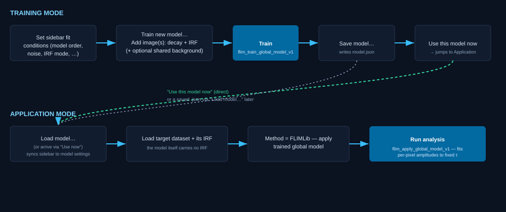

**Training mode** — click **Train new model…** in the GLOBAL MODEL
section to open the Training dialog:
1. Optionally set a **Shared IRF** / **Shared background** at the top
   of the dialog to reuse the same reference data for every training
   image, instead of being asked per image.
2. Click **Add image(s)…** to build the training set — each row needs a
   decay file and an IRF (background optional). All training images must
   share the same number of time bins **and the same time-bin width
   (ns)** — Train refuses to proceed otherwise, naming the mismatched
   file. The file picker accepts multiple files at once (ctrl/shift-click)
   — with a **Shared IRF**/**Shared background** set per step 1, every
   selected file is added straight in with no further prompts; without
   one, each file still gets its own IRF/background prompt, same as
   adding one at a time.
3. Training uses whatever **Model order**, **Noise model**, **Fit
   background**, **IRF mode**, **Global iterations**, and **Max
   pixels** are currently set in the *main window's sidebar* — set
   those first, since the dialog doesn't duplicate those controls.
   **Time-bin width is the one exception**: training always uses the
   added images' own bin width (validated in step 2 above), never
   whatever the sidebar's Time-bin width field happens to show — that
   field reflects whichever dataset is loaded in the *main* window, which
   has no necessary connection to this dialog's training set.
4. There are three ways for a global/multi-stretched fit to get its
   starting τ (and, for the multi-stretched distribution model, h)
   values — pick one before clicking Train:
   - **Unseeded** (the default): leave the sidebar's **Initial τ
     values** field blank and the dialog's **Auto-seed from phasor
     analysis** box unchecked. The native fit searches from several
     built-in starting points on its own and keeps whichever converges
     best. Reliable for Model order 1-2; for Model order 3 (three
     independently-distributed components, multi-stretched distribution
     model only) this can miss one component — prefer one of the two
     options below for that case.
   - **Manual**: type comma-separated starting values into the
     sidebar's **Initial τ values (ns, comma separated)** field
     (τ1, h1, τ2, h2, … for
     the multi-stretched distribution model; τ1, τ2,
     … for ordinary multi-exponential). Use this when you already know
     roughly what lifetimes to expect (e.g. from the literature or a
     simpler prior fit) — an explicit value here always takes priority
     over the phasor option below.
   - **Auto-seed from phasor analysis** (the dialog's own checkbox,
     multi-stretched distribution model only): leave **Initial τ
     values** blank and check this box instead. Derives a starting
     (τ, h) guess for every component automatically from this training
     set's own phasor structure — no manual guess needed, and reliably
     finds all the components (including for Model order 3, where plain
     unseeded fitting can miss one). Falls back to the ordinary
     unseeded search if a usable seed can't be derived from this
     particular data (e.g. too few valid pixels) rather than failing
     outright.
5. Set a **Model name** (or leave blank for an auto-generated one),
   then click **Train**. This calls `flim_train_global_model_v1` in the
   native DLL, fitting shared τ values across every pixel of every
   training image at once — up to the sidebar's **Max pixels** cap in
   total, split fairly across however many images are in the table (each
   gets its own random share of that budget), so every training image
   actually contributes to the fit regardless of its size or position in
   the list.
6. Once training finishes, the **Px used/total** column reports exactly
   how many of each image's pixels went into the fit — every row should
   show a non-trivial share; if one shows 0, something about that image
   (its mask, minimum-count threshold, or IRF) excluded it entirely.
   **Save model…** writes the result to a `.json` file. **Use this model
   now** wires the just-saved model straight into the main window's
   Application mode (§4.7) without a separate load step.

### 4.7 FLIMLib — apply trained global model (Application mode)
Applies a previously trained model's fixed τ values to a *new* dataset
(via `flim_apply_global_model_v1`), fitting only per-pixel amplitudes
against those fixed lifetimes.

1. **Load model…** (or arrive here via **Use this model now** from
   Training) to select the `.json` model file.
2. Loading a model automatically syncs the sidebar's Model order, Noise
   model, Fit background, IRF mode, thresholds, fit bin range, and
   native-fit bin settings to match what the model was *trained* with
   — applying under different conditions than training would give
   invalid results, so these are locked to the model rather than left
   editable.
3. You still need to **Load IRF** for the dataset you're applying to
   (and load the sample data itself) — the model doesn't carry the IRF
   itself, only the fitting conditions and fixed τ values. Applying
   with the synthetic Gaussian IRF source is possible but not
   recommended here: the model's fixed τ values were calibrated against
   whatever real IRF it was trained with, so a different (synthetic)
   IRF at apply time can give inconsistent results.
4. Run the analysis as normal (`Run analysis` / `Run current
   analysis`).

---

## 5. Viewing results

After a run, the metrics strip (top of the content area) shows valid-
pixel count, mean τ, a representative τ, max processed counts, and mean
χ². Below it, seven tabs:

### 5.1 Overview

See the screenshot in §1 — this tab is what's shown there.

The main working view:
- **Intensity** map (left) and a **second map** (right) — the second
  map's mode is chosen via the top-right dropdown: `Intensity`,
  `Intensity with threshold`, `Lifetime`, or `Composite` (intensity-
  weighted lifetime colour).
  - **Log-scale intensity** checkbox toggles both intensity displays
    between linear and log scaling.
  - `Intensity with threshold` shows a **Preview threshold** slider/
    entry; **Use for fit** copies that live threshold value into the
    sidebar's fit/phasor minimum-count fields.
  - **Available before running analysis, not just after**: as soon as a
    dataset is loaded, switching the second map to `Intensity` or
    `Intensity with threshold` previews raw photon counts (summed over
    time, spatially binned exactly as **Spatial bin radius** — §3,
    Preprocessing — is currently set) — so you can pick a sensible
    threshold, and see how it interacts with binning, before spending time
    on a full run. Changing the spatial bin radius live-updates this
    preview. It's still only a preview: background subtraction, the
    timing offset, and row/column interpolation aren't applied until a
    real analysis run, which is what actually determines which pixels get
    fitted.
- **Selected-point decays** (bottom-left) — decay curves for every
  point you've clicked, plus the ROI's mean decay if one is drawn.
- **Selected phasors** and **Lifetime histogram** (bottom-right) — the
  phasor cloud and lifetime distribution for the current selection
  (whole image, ROI, or selected points), shown side by side.
- Toolbar: **Undo** (last point), **Clear points**, **Clear ROI**.

**Map interactions** (on the Intensity/second map):
- **Click** — add a comparison point (shown in Selected-point decays).
- **Click + drag** — draw a rectangular ROI.
- **Right-click** (no drag) — clear the current ROI/points on that map.
- **Right-click + drag** — pan when zoomed in.
- **Scroll wheel** — zoom in/out (1×–16×), centred on the cursor.
- Click the yellow zoom-percentage badge (top-right, appears when
  zoomed) to reset zoom.

### 5.2 Decay & fit

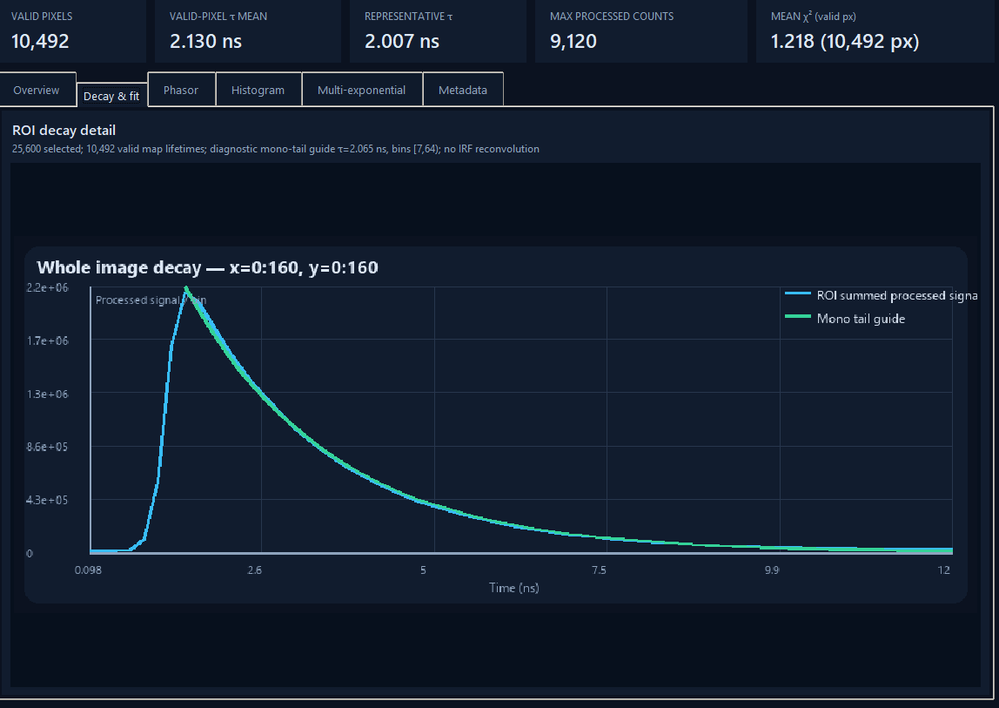

A larger single view of the ROI decay detail — drag a region on an
Overview map to populate it.

### 5.3 IRF & Decay

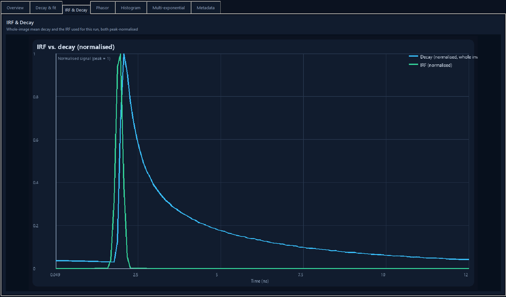

The whole-image mean decay and the IRF actually used for the current
run (loaded file or synthetic Gaussian, whichever applies — §3), both
peak-normalised onto the same 0–1 scale so their relative timing and
width can be compared directly, regardless of the very different
absolute magnitudes a measured decay and an IRF trace naturally have.
If no IRF was used at all, only the decay curve is shown, with the
title noting that. Updates automatically after every run.

### 5.4 Phasor

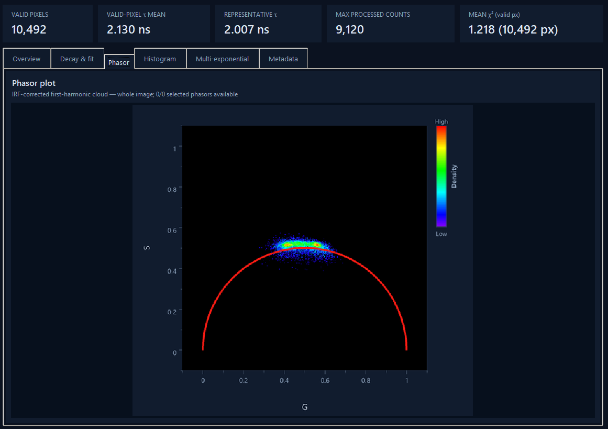

The full-size phasor plot: first-harmonic (G, S) cloud on the universal
semicircle, coloured by density if **Phasor density heatmap** is
enabled.

### 5.5 Histogram

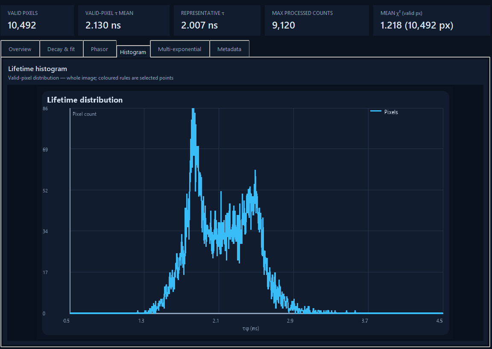

The full-size lifetime histogram (uses **Detailed histogram bins**).

### 5.6 Multi-exponential

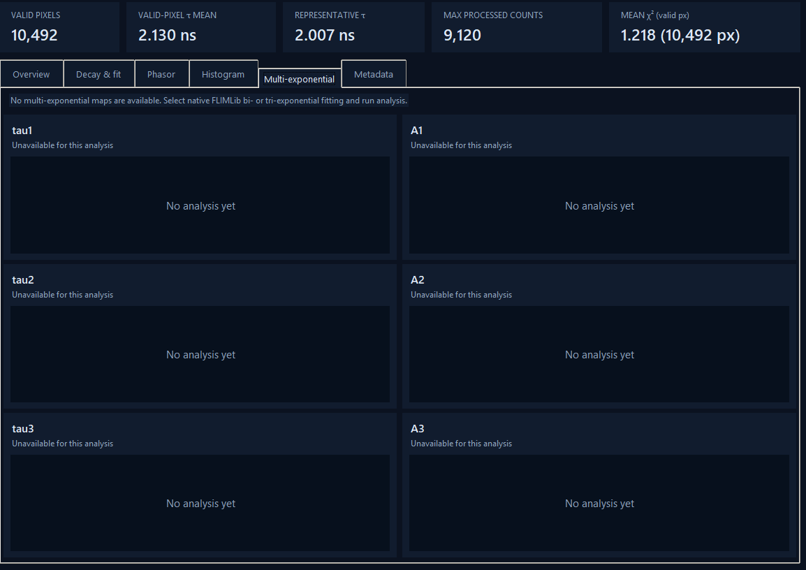

Populated after a bi- or tri-exponential native fit (§4.6): a grid of
τ and amplitude maps, one row per fitted component (τ1/A1, τ2/A2,
τ3/A3 as applicable).

### 5.7 Metadata

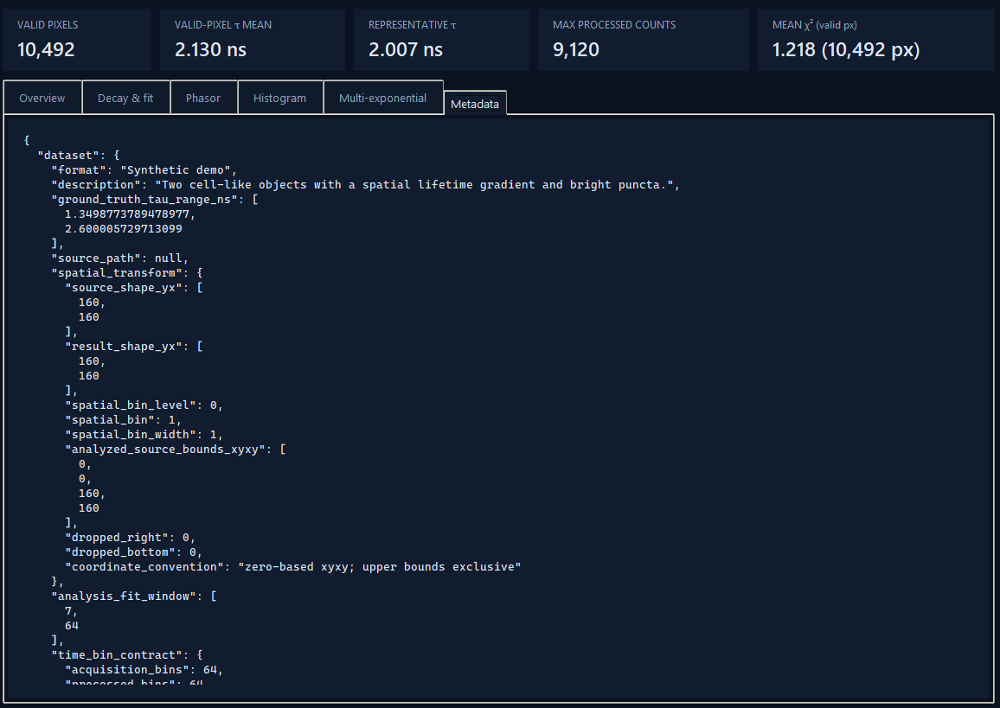

Full JSON provenance for the current result — every setting used,
background-correction details (applied multiplier, formula, fraction
of bins clipped), interpolation-map details, DLL hash, the synthetic
IRF's estimated parameters (if used), etc. Useful for confirming
exactly how a result was produced.

---

## 6. Processing pipeline reference

### 6.1 Order of operations
1. Background subtraction and zero-clipping
2. Timing shift
3. Detector-row interpolation (if enabled)
4. Detector-column interpolation (if enabled)
5. Automatic extreme-pixel interpolation (if enabled)
6. Smoothing
7. Spatial binning (a rolling window — see §3; the image size is
   unchanged by this step)
8. Phasor calculation and/or fitting (using the synthetic Gaussian IRF
   here, if that's the selected IRF source — generated at this point
   from the fully-preprocessed decay, so it always matches this run's
   own timing exactly)

Background subtraction happens first and applies to everything
downstream — see the Metadata tab's `background_correction` block for
the exact formula and stats from any given run.

### 6.2 Queue processing: three ways to run multiple files
- **Selecting an unprocessed queue entry** — loads and displays it, but
  doesn't run analysis automatically; use **Run analysis**. (A `.lif`
  entry instead opens the Leica export picker — §2.3.)
- **Process queue…** — runs analysis on every queued file and keeps up
  to **Keep in memory** results cached (an LRU cache: least-recently-
  viewed results are evicted first once the cap is hit). Click any `●`
  entry afterwards to view its cached result instantly, no re-run.
  Nothing is written to disk by this button. `.lif` entries are skipped
  with a clear message.
- **Process & export queue** — runs analysis on every queued file and
  writes each result straight to disk (§6.3) as it completes, without
  keeping them in memory. Use this for a full batch export. `.lif`
  entries are skipped the same way.

### 6.3 Exporting
**Export** (current result) or **Process & export queue** (per file)
write, per dataset, into the chosen folder:
- `<name>_analysis.npz` — raw arrays (intensity, lifetime, valid mask,
  G/S, phase/modulation τ, χ², mean decay/fit, fit diagnostics).
- `<name>_summary.json` — the same provenance shown in the Metadata
  tab.
- PNGs: intensity, lifetime, composite, histogram, phasor, decay_fit,
  dashboard, and (for multi-exponential results) one lifetime map per
  component.
- `<name>_lifetime_histogram.csv` — histogram bin centres and counts.

If an ROI or selected points are active when using **Export**, their
own decay/analysis data is exported alongside the main result.

---

## 7. Keyboard shortcuts
- `Ctrl+O` — Open decay files
- `Ctrl+R` — Run analysis
- `Ctrl+E` — Export current result
- `Esc` — Clear ROI

---

## 8. Standalone executable

FLIM Studio can be packaged as a standalone `.exe` that runs without a
Python installation — see [BUILDING.md](BUILDING.md) for build steps
and troubleshooting.

---

## 9. A note on the diagrams

Every panel/tab image in this manual is a real screenshot
(`docs/manual_assets/screenshots/*.png`), except one: the
Training/Application workflow diagram in §4.6 —
`docs/manual_assets/global_model_workflow.svg` — which is still a
schematic flowchart, since no screenshot of the Training dialog has
been supplied yet. Send one (and any others you'd like added — e.g. the
row/column-map preview overlay) and it'll get dropped in the same way
these were.
